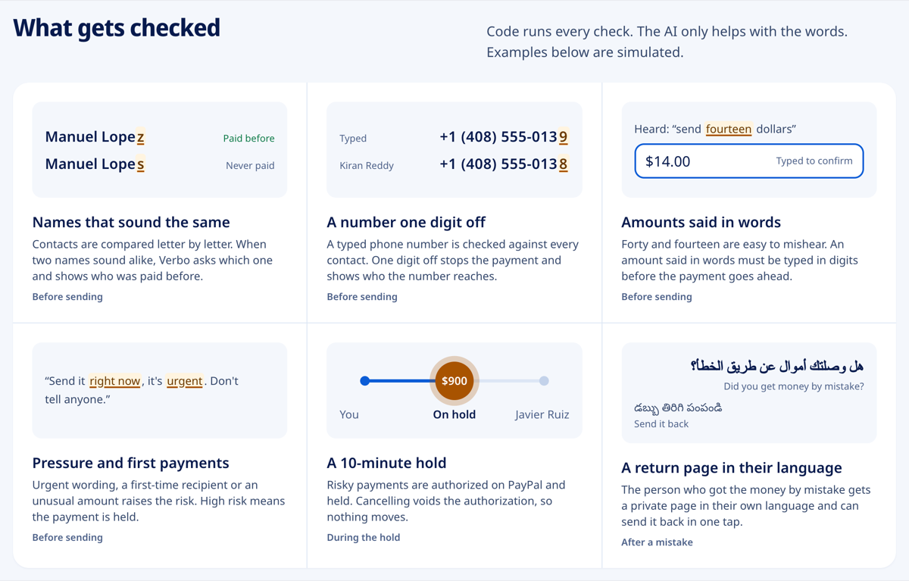
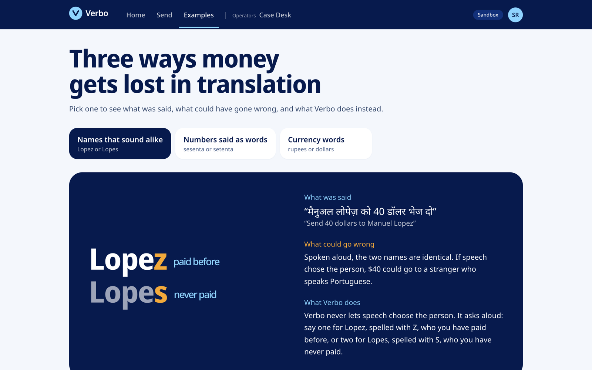
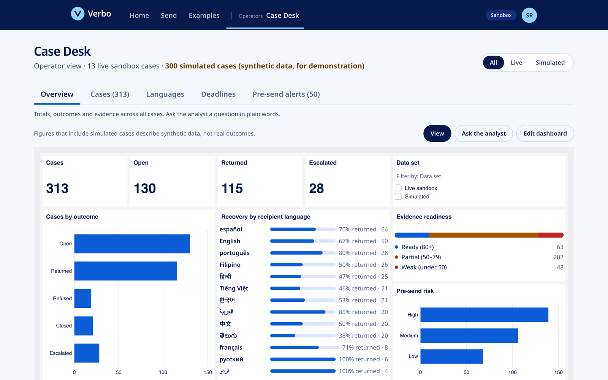

<div align="center">

# Verbo

**Voice payments on PayPal that survive translation.**

Say a payment in your own language. Verbo checks the name and the amount with code, reads the payment back in your
language, and helps you get the money back if it still goes to the wrong person.

### [Try it live → verbo-371g.onrender.com](https://verbo-371g.onrender.com)


<br>


<sub>The Home page demo: one payment in English, Hindi, Telugu and Arabic. The amount reads $40.00 in every language. Simulated data, no money moves.</sub>

</div>

<br>

## Contents

[Try it in 60 seconds](#try-it-in-60-seconds) · [Why](#why) · [What makes it different](#what-makes-it-different) · [What you see](#what-you-see) · [How it works](#how-it-works) · [Does it work?](#does-it-work) · [Built with](#built-with) · [Run it locally](#run-it-locally) · [Limits and what's next](#limits-and-whats-next) · [References](#references) · [Layout](#repository-layout)

## Try it in 60 seconds

The live site runs in mock mode: no PayPal login is needed, and no money moves.

1. Open **[verbo-371g.onrender.com](https://verbo-371g.onrender.com)**. It runs on Render's free plan, so the first visit after
   15 idle minutes can take up to a minute to wake up.
2. On **Home**, pick a language under the phone and watch the same payment play in it.
3. Go to **Send**, choose *Type instead*, and type `Send 40 dollars to Manuel`. Verbo asks which Manuel you mean, because two
   contacts sound the same.
4. On **Send**, choose *Pay a phone number*, enter `+1 (408) 555-0139` and `60`. Verbo stops: that number is one digit off
   Kiran Reddy's, and it belongs to someone who reads PayPal in Arabic.
5. Open **Examples** for three short stories, and **Case Desk** for the operator view.

## Why

This project started with a real case. A grandfather who speaks only Telugu sent money to a wrong number. The person who
received it spoke Hindi. Nobody could talk to each other, and the money was never recovered.

Person-to-person payments assume that the sender and the recipient understand each other. When they don't, small mistakes
become permanent: a name that sounds like another name, a phone number one digit off, *forty* heard as *fourteen*. Voice
assistants make paying easier, and they also make these mistakes easier. Verbo is a prototype of a safety layer PayPal could
build into its own app, so money is not lost to a language barrier.

## What makes it different

- **Language-proof money.** The words change between languages; the name and the amount don't. Every read-back is a fixed
  template, and code writes the checked values into it. The amount is always written `$40.00`, even inside Arabic.
- **The AI never decides money.** Gemini only turns speech into a strict schema. Code checks the amount against what was
  actually said, resolves the recipient, scores the risk and decides whether to hold the payment.
- **Recovery works across languages.** The person who got the money by mistake gets a private page in their own language,
  a translated chat, and a one-tap return. They are treated as someone who wants to help.
- **Every line has English under it.** Anyone helping the sender, a judge or an operator, can follow every screen.

## What you see

<table>
<tr>
<td width="50%" valign="top">

<br><b>Read-back in the sender's language.</b> A fixed template in Arabic, with its English under it. The amount stays
<code>$30.00</code> inside right-to-left text. A sound-alike contact is shown with the one different letter marked.
</td>
<td width="50%" valign="top">

<br><b>A number one digit off.</b> Code compares every typed number with every contact's. It shows who the number reaches,
the language they read, their local time, and offers the contact instead.
</td>
</tr>
</table>

<div align="center">

</div>

| Check | What happens |
|---|---|
| **Names that sound the same** | Compared letter by letter, across scripts. Verbo asks "one or two?" aloud and shows who was paid before. |
| **A number one digit off** | The payment stops before review and offers the contact you probably meant. |
| **Amounts said in words** | *Forty* and *fourteen* are easy to mishear, so an amount said only in words must be typed in digits. |
| **Pressure and first payments** | Urgent wording, a first-time recipient or an unusual amount raises the risk score. |
| **A 10-minute hold** | High-risk payments are authorized on PayPal and held. Cancelling voids the authorization. |
| **Recovery in their language** | A signed, expiring link to a page in the recipient's language, with a one-tap return. |

<table>
<tr>
<td width="50%" valign="top">

<br><b>Examples.</b> Three short stories: what was said, what could have gone wrong, and what Verbo does instead.
</td>
<td width="50%" valign="top">

<br><b>Case Desk.</b> The operator view: recovery cases, a language grid, a deadline timeline and an evidence packet per case.
Most cases here are simulated and labelled as such.
</td>
</tr>
</table>

## How it works

<div align="center">

</div>

1. **Speak.** Groq Whisper turns speech into text. Typing works too.
2. **Extract.** Gemini fills a strict zod schema: recipient, amount, currency. If the model fails or isn't configured, a
   rules parser takes over.
3. **Code checks.** The amount must appear in what was said (Telugu, Devanagari and Arabic digits are normalised). Only US
   dollars are accepted, and Verbo never converts. The recipient is resolved against the address book, sound-alike names and
   near-miss numbers are found, and a risk score decides whether to hold.
4. **Read back.** A fixed template in the sender's language states the payment, with English under it. ElevenLabs reads
   it aloud. Follow-up questions also come from fixed templates.
5. **Confirm.** The final step is always a tap, then approval on PayPal's own page, opened in the sender's language.
6. **PayPal.** The order is authorized first and captured only after any hold. Every money-changing call carries an
   idempotency key (`PayPal-Request-Id`, payout `sender_batch_id`).

The recovery coach drafts the message asking for the money back. It only suggests text: the sender edits and sends it, and
code drops any draft containing a link, contact details, or a number other than the case amount.

## Does it work?

All numbers below come from Verbo's own scripted scenarios and test runs. There are no real users, no real voice audio and no
fraud data behind them.

| What | Result | Source |
|---|---|---|
| Scripted scenarios, offline rules parser | **57 / 57** matched the expected recipient, amount and risk (or the expected refusal) | [docs/eval/eval.md](docs/eval/eval.md) |
| Same scenarios with Gemini | **57 / 57** | [docs/eval/eval-gemini.md](docs/eval/eval-gemini.md) |
| Deliberately wrong model output | **11 / 11** caught by code validation | both eval reports |
| Unit and integration tests | **231** passing | `npm test` |
| Live PayPal sandbox money loop (Nov 5, 2026) | Send → authorize → capture → payout ✅ · risk hold → void ✅ · return payment ✅ | [docs/plan/STATUS.md](docs/plan/STATUS.md) |

The scenarios cover English, Telugu, Hindi, Spanish, Portuguese and Arabic, native-script digits, decimal commas,
sound-alike names, pressure wording, unusual amounts, unsupported currencies and off-topic requests. The rules parser and the
scenarios were written by the same team, so a high offline score mainly shows the parts agree with each other; the eval
report lists every expectation that was corrected and why.

## Built with

| Tool | How Verbo uses it | Where |
|---|---|---|
| **PayPal** Orders v2, Payments v2, Payouts v1, Webhooks (sandbox) | Authorize, hold, capture, void, payout, and the return payment. Every call was checked against PayPal's OpenAPI specs. | `lib/paypal/` |
| **APIMatic** | PayPal's Server SDK, generated by APIMatic, creates every order and opens PayPal's page in the person's language. Each payment page lists the PayPal calls behind it. The PayPal Context Plugin was used to review that code. | `lib/paypal/sdk.ts`, `lib/paypal/trail.ts`, [notes](docs/guides/apimatic.md) |
| **Gemini** | Speech understanding into a strict schema, chat translation, the recovery coach, and the Case Desk analyst | `lib/agents/` |
| **Groq Whisper** | Speech to text | `lib/speech/`, `app/api/stt/` |
| **ElevenLabs** | Reads the payment and the follow-up questions aloud, in one voice ("River"). Browser voice when no key is set. | `lib/speech/elevenlabs.ts` |
| **AG Grid** and AG Studio | Case grid, dashboard, a sender × recipient language grid, and the people you can pay on Send, grouped by how their names sound | `app/desk/`, `components/send/PeopleGrid.tsx` |
| **Bryntum** Scheduler Pro | Recovery deadlines; drag a bar to change when a case escalates. Each row shades night where the recipient lives, and reminders wait for their morning. | `app/desk/timeline/`, `lib/people/localTime.ts` |
| **Render** | Hosts the live demo: web service and Postgres from one Blueprint | [`render.yaml`](render.yaml), [deploy guide](docs/guides/DEPLOY.md) |

**Languages.** Read-backs are written for six languages: English, Hindi, Telugu, Spanish, Portuguese and Arabic (right to
left). The five non-English template sets are machine-translated and not yet reviewed by native speakers; the app says so.
The speech provider lists 60 languages ([coverage](docs/guides/language-coverage.md)).

**Accessibility.** Large type, WCAG 2.1 AA contrast, full keyboard and screen-reader support, right-to-left layout, and
reduced motion respected.

## Run it locally

Works with no keys, using mock payments and the rules parser.

```bash
npm install
cp .env.example .env
npm run dev
```

Open http://localhost:3000. Add keys to `.env` to use real services; `npm run check-env` lists which are set, by name only.

```bash
npm test                 # Vitest
npm run typecheck
npm run eval             # scripted scenarios, writes docs/eval/
npm run verify-templates # keys, placeholders, no digits, script direction
npm run money-loop       # sandbox: order → authorize → capture → payout, void path, return path
```

To re-make the README images after a UI change, run the dev server, then `node scripts/readme-shots.mjs` (needs Google Chrome;
the GIF also needs ffmpeg).

## Limits and what's next

- **Sandbox only.** No real money moves, and the live demo runs in mock mode so judges don't need a PayPal login.
- **Templates need native review.** Hindi, Telugu, Spanish, Portuguese and Arabic were machine-translated.
- **No real microphone tests yet.** Speech was tested with simulated recordings and transcripts.
- **Simulated data.** Contacts, history and most Case Desk cases are synthetic and labelled "simulated".
- **Free hosting.** The live site sleeps after 15 idle minutes, its database expires after 30 days, and the hourly reminder
  job isn't deployed (Render has no free scheduled jobs). Reminders and links are shown, not sent by SMS or email.
- **Recovery is voluntary.** Verbo cannot take money from anyone's account.
- **Next:** native-speaker review of the templates, real audio tests, delivering recovery links by SMS, and more read-back
  languages from the provider's list.

## References

**PayPal and APIMatic**

1. PayPal REST APIs: [Orders v2](https://developer.paypal.com/docs/api/orders/v2/), [Payments v2](https://developer.paypal.com/docs/api/payments/v2/), [Payouts v1](https://developer.paypal.com/docs/api/payments.payouts-batch/v1/), [Webhooks](https://developer.paypal.com/api/rest/webhooks/), and [idempotency](https://developer.paypal.com/api/rest/reference/idempotency/).
2. [PayPal Server SDK](https://developer.paypal.com/serversdk/typescript/getting-started/how-to-get-started), generated by [APIMatic](https://www.apimatic.io/).

**AI and speech**

3. Google Gemini API: [structured output](https://ai.google.dev/gemini-api/docs/structured-output).
4. [zod](https://zod.dev/): the schema the model output must pass.
5. Groq: [speech to text](https://console.groq.com/docs/speech-to-text).
6. ElevenLabs: [text to speech](https://elevenlabs.io/docs/capabilities/text-to-speech).

**Language and accessibility**

7. W3C: [inline markup and bidirectional text](https://www.w3.org/International/articles/inline-bidi-markup/) (why every value is wrapped in `<bdi>`).
8. MDN: [Intl.NumberFormat](https://developer.mozilla.org/en-US/docs/Web/JavaScript/Reference/Global_Objects/Intl/NumberFormat) and [Intl.DisplayNames](https://developer.mozilla.org/en-US/docs/Web/JavaScript/Reference/Global_Objects/Intl/DisplayNames).
9. W3C: [WCAG 2.1](https://www.w3.org/TR/WCAG21/).

**Interface and hosting**

10. [AG Grid](https://www.ag-grid.com/) and AG Studio · [Bryntum Scheduler Pro](https://bryntum.com/products/schedulerpro/) · [Render Blueprints](https://render.com/docs/blueprint-spec).

## Repository layout

| Folder | What is in it |
|---|---|
| `app/` | Screens (Home, Send, Examples, recovery page, Case Desk) and API routes |
| `components/` | `ui/` shared pieces, `home/` the Home page, `send/` the Send flow |
| `lib/` | `core/` config and logging, `people/` simulated contacts and name checks, `paypal/`, `transfers/`, `recovery/`, `risk/`, `agents/`, `bridge/` (languages and templates), `speech/`, `desk/`, `evidence/` |
| `db/` | Database schema, client and migrations |
| `scripts/` | Command-line tools: environment check, sandbox money loop, evaluation, language list, README images |
| `tests/` | Vitest suites |
| `docs/` | `plan/` brief and status, `eval/` scripted evaluation results, `guides/` deployment and APIMatic notes, `img/` README images |

## License

[MIT](LICENSE). Verbo is an independent hackathon project that runs on the PayPal sandbox. It is not a PayPal product.
