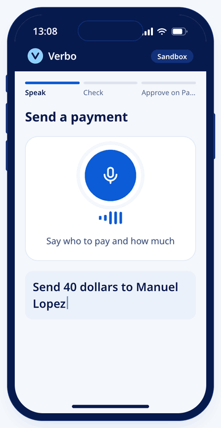
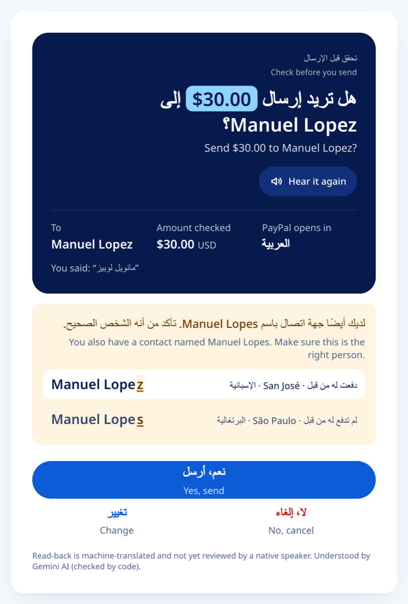
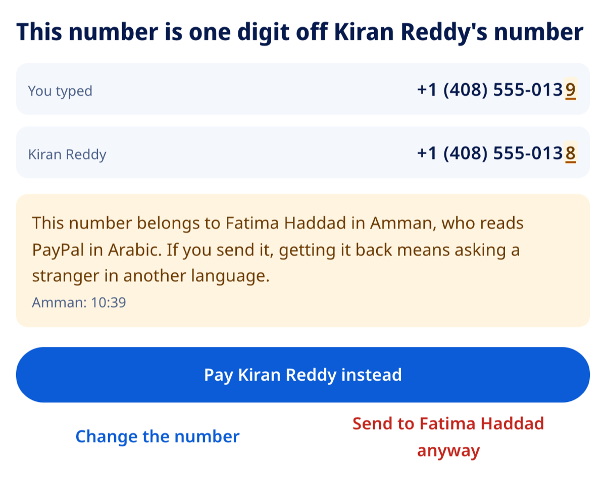
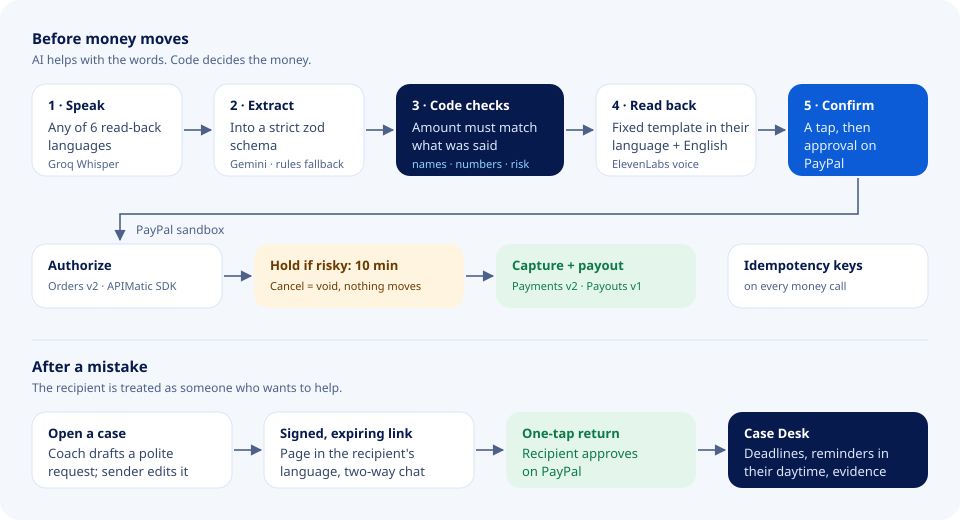

<div align="center">

# Verbo

**Voice payments on PayPal that survive translation.**

Say a payment in your own language. Verbo checks the name and the amount with code, reads the payment back in your
language, and helps you get the money back if it still goes to the wrong person.

**[Live demo](https://verbo-371g.onrender.com)** · **[Run it locally](#run-it-locally)** · **[Tools used](#tools-used)** · **[MIT license](LICENSE)**

<!-- Demo video: add the YouTube link here -->



<sub>One payment in English, Hindi, Telugu and Arabic. The amount reads $40.00 in every language. Simulated data; no money moves.</sub>

</div>

## What it is

People send money to family and friends every day in a language that isn't their first. A name that sounds like another
name, a phone number one digit off, *forty* heard as *fourteen*: small mistakes send money to the wrong person. When that
person speaks another language, there is often no way to even ask for it back.

Verbo is a safety layer for PayPal person-to-person payments. The words can change between languages; the name and the
amount can't. An AI model only turns speech into structured fields. Code checks them, a fixed template reads them back, and
the person confirms before PayPal approves anything.

## Features

**Before the money moves**

- **Speak or type a payment** in English, Hindi, Telugu, Spanish, Portuguese or Arabic (right to left).
- **Read-back in your language**, from a fixed template with English underneath. The amount is always written `$40.00`, and
  it is read aloud.
- **Names that sound the same.** Two contacts called Lopez and Lopes? Verbo asks which one, out loud, in your language.
- **A number one digit off.** Verbo stops, shows who the number really reaches and the language they read, and offers the
  contact you probably meant.
- **Amounts said in words** must be typed in digits, because *forty* and *fourteen* are easy to mishear.
- **Risk hold.** Pressure wording, a first payment or an unusual amount raises the risk. Risky payments are authorized on
  PayPal and held for 10 minutes; one tap cancels and voids the authorization.

**After a mistake**

- **Asking for the money back.** AI drafts a polite request; the sender edits and sends it.
- **A page in the recipient's language.** A signed, expiring link opens a private page with a translated chat and a one-tap
  return through PayPal.
- **Case Desk** for operators: every case, a sender × recipient language grid, recovery deadlines on a timeline, and an
  evidence packet (PDF, JSON and SHA-256) per case.

<table>
<tr>
<td width="50%" valign="top">

<br><b>Read-back in Arabic.</b> The amount stays <code>$30.00</code> inside right-to-left text, and a sound-alike contact is
shown with the one different letter marked.
</td>
<td width="50%" valign="top">

<br><b>A number one digit off.</b> Verbo shows who the number reaches, the language they read and their local time, and
offers the contact instead.
</td>
</tr>
</table>

## Try the live demo

**[verbo-371g.onrender.com](https://verbo-371g.onrender.com)** runs in mock mode: no PayPal login, no keys, and no money
moves. It is on Render's free plan, so the first visit after 15 idle minutes can take up to a minute to load.

1. On **Home**, pick a language under the phone and watch the same payment play in it.
2. Go to **Send**, tap the microphone and say "Send 40 dollars to Manuel" (or choose *Type instead*). Verbo asks which Manuel
   you mean, because two contacts sound the same.
3. On **Send**, choose *Pay a phone number* and enter `+1 (408) 555-0158` and `60`. Verbo stops: the number is one digit off
   Lakshmi Rao's, and it belongs to someone who reads PayPal in Spanish.
4. Type `Send 300 dollars to Kiran now. It's urgent, don't tell anyone.`, confirm and approve. The payment is held for
   10 minutes; tap *Cancel this payment* and nothing moves.
5. Open **Examples** for three short stories, and **Case Desk** for the operator view.

## Run it locally

Requires **Node.js 20 or later**. No keys or database are needed: by default Verbo uses mock PayPal, an offline rules
parser and an embedded database (PGlite).

```bash
git clone https://github.com/Vrinda072/verbo.git
cd verbo
npm install
cp .env.example .env
npm run dev
```

Open http://localhost:3000.

**Optional keys** (in `.env`; `npm run check-env` lists which are set, by name only):

| Variable | Turns on |
|---|---|
| `GEMINI_API_KEY` | Gemini for extraction, translation and the recovery coach (free key from Google AI Studio) |
| `GROQ_API_KEY` | Whisper speech-to-text (otherwise the browser's own recognition) |
| `ELEVENLABS_API_KEY` | The read-aloud voice (otherwise the browser's voice) |
| `PAYPAL_CLIENT_ID`, `PAYPAL_CLIENT_SECRET`, `MOCK=0` | Real PayPal **sandbox** calls |
| `AG_GRID_LICENSE_KEY` | Removes the AG Grid Enterprise watermark |
| `DATABASE_URL` | Postgres instead of the embedded database |

```bash
npm test                 # 232 Vitest tests
npm run typecheck
npm run eval             # scripted scenarios, results in docs/eval/
npm run money-loop       # PayPal sandbox: send, void and return paths (needs sandbox keys)
```

To host your own copy, [`render.yaml`](render.yaml) deploys the web service and Postgres in one step
([deploy guide](docs/guides/DEPLOY.md)).

## Tools used

**AI models and services**

| Tool | How Verbo uses it |
|---|---|
| **Google Gemini** (`gemini-3.5-flash-lite`, `gemini-3.1-flash-lite`, `gemini-3.6-flash`) | Turns what was said into a strict zod schema (recipient, amount, currency); translates the recovery chat; drafts the money-back request; summarises cases on the Case Desk. It never decides money: code validates every field, and a rules parser takes over if the model fails. |
| **Groq Whisper** (`whisper-large-v3-turbo`) | Speech-to-text for the microphone on Send. |
| **ElevenLabs** (`eleven_v4_turbo`) | Reads the payment and the follow-up questions aloud in the sender's language, in one voice. |

**PayPal and partner tools**

| Tool | How Verbo uses it |
|---|---|
| **PayPal** Orders v2, Payments v2, Payouts v1, Webhooks (sandbox) | Authorize, hold, capture, void, payout and the return payment. Every money-changing call carries an idempotency key. |
| **APIMatic** | The PayPal Server SDK, generated by APIMatic, creates orders and opens PayPal's page in the person's language. Each payment page lists the PayPal calls behind it. ([notes](docs/guides/apimatic.md)) |
| **AG Grid** and **AG Studio** | Case Desk grid and dashboard, the language grid, and the people you can pay on Send, grouped by how their names sound. |
| **Bryntum** Scheduler Pro | Recovery deadlines on the Case Desk; each row shades night-time where the recipient lives. |
| **Render** | Hosts the live demo (web service and Postgres). |

**Built with:** Next.js, TypeScript, Drizzle ORM, PGlite / Postgres, zod and Vitest. The demo video was made with Remotion
and ElevenLabs voices.

## How it works

<div align="center">

</div>

1. **Speak.** Whisper turns speech into text.
2. **Extract.** Gemini fills a strict schema.
3. **Check.** Code confirms the amount appears in what was said (native-script digits included), resolves the recipient,
   finds sound-alike names and near-miss numbers, and scores the risk.
4. **Read back.** A fixed template in the sender's language, with English underneath, read aloud by ElevenLabs.
5. **Confirm.** The person taps to confirm, then approves on PayPal's own page.
6. **Pay.** PayPal authorizes first and captures only after any hold.

**Tested with our own scripted scenarios** (no real users or fraud data): 57 of 57 scenarios matched the expected result
with both the offline parser and Gemini, and 11 of 11 deliberately wrong model outputs were caught by code
([eval report](docs/eval/eval-gemini.md)). The full sandbox money loop ran against PayPal on Nov 5, 2026.

## Notes

- **Sandbox only.** No real money moves. People, phone numbers and most Case Desk cases are simulated and labelled so.
- The five non-English template sets were machine-translated and have not yet been reviewed by native speakers.
- Verbo is an independent hackathon project, not a PayPal product.

## License

[MIT](LICENSE)
